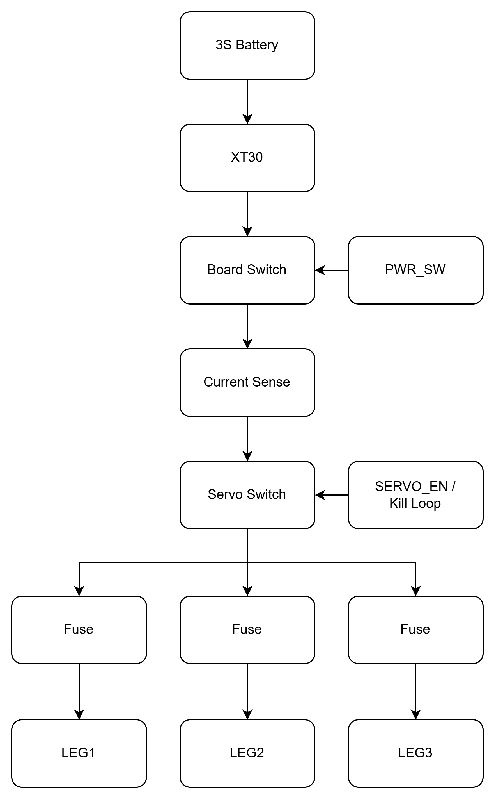

# Leg hub

> ⚠️ **v0.1: under development.** The design may change, and the board hasn't been fully verified. Check everything against the schematic before you power it up.

The leg hub is the power and data board for one side of the hexapod. Every robot uses **two identical boards**, one for the left legs and one for the right. Each board:

- **Distributes power and servo data to three legs** through individually fused connectors.
- **Makes 5 V / 5 A** for the Raspberry Pi, sensors and other peripherals.
- **Measures current, voltage and power** for its side with an INA226 on I²C.
- **Switches servo power** with a fail-safe high-side switch that needs both a GPIO enable and a closed kill loop.
- **Switches itself fully on and off** from one small latching switch.

## Specifications

| | |
|---|---|
| Input | 3S LiPo (9.0–12.6 V) via XT30 |
| Board switch | P-FET, about 15 A per board |
| Leg outputs | 3 × fused 5 A (mini blade), battery voltage |
| 5 V output | 5 A synchronous buck (TPS56528), 650 kHz |
| Current sense | INA226, 2 mΩ shunt, about 40 A full scale |
| Host logic | 3.3 V (default) or 5 V, selected by JP3 |
| Input protection | SMBJ13A TVS, 220 µF + 470 µF bulk |
| Mounting | 4 × M3 |

## How the board works

  <picture>
    <source media="(prefers-color-scheme: dark)" srcset="images/power-flow-dark.png">
    
  </picture>

Servo data comes in on BUS_IN (J6) and is shared to the data pin of all three leg connectors.

1. **Board switch (Q3).** The board stays off until J11 is shorted. If the switch is open or a wire breaks, R18 turns Q3 off and everything on that board loses power: buck, Pi and servos. Only about 1 mA flows through the switch, so any small latching switch works.
2. **Current sense (U2, R1).** The shunt sits after Q3, so the INA226 measures everything the board draws: servos plus 5 V load.
3. **Servo switch (Q1).** Servo power comes on only when **SERVO_EN is high and the kill loop (J8) is closed**. R5 holds the servos off while the host GPIO floats during boot.
4. **Leg outputs.** Each leg has its own 5 A blade fuse, matched to the roughly 3 A-per-pin rating of the servo connectors (brief peaks are fine).
5. **Servo data.** Data from the bus servo adapter is shared to all three legs, each through a 22 Ω series resistor and an ESD clamp.
6. **Adapter power.** J6 pin 2 feeds the switched servo rail to the bus servo adapter through a Schottky diode (D7), to power the adapter's own chips. The diode stops the adapter feeding power back into the board. This feed isn't fused, so don't power servos or anything else through the adapter. Servo power goes to the legs only through J3–J5.

## Connectors

| Ref | Name | Type | Pinout / use |
|---|---|---|---|
| J1 | Battery in | Amass XT30PW-M | 3S pack. Check polarity against your lead. |
| J2 | 5 V out | Molex Micro-Fit 3.0, 2-pin | 5 V / 5 A for the Pi, sensors or other peripherals |
| J3–J5 | LEG1–LEG3 | Molex SPOX 5267-03A (2.5 mm) | 1 DATA · 2 V+ (fused) · 3 GND. Same pinout as the servos, so a straight-through servo cable works. |
| J6 | BUS_IN | Molex SPOX 5267-03A | To the bus servo adapter: 1 DATA · 2 V out to the adapter (servo rail through D7, for the adapter's chips only) · 3 GND |
| J7 | CTRL | JST PH, 5-pin | To the host (Pi / ESP32 / Pico / Arduino): 1 SDA · 2 SCL · 3 INA ALERT (open-drain) · 4 SERVO_EN · 5 GND |
| J8 | KILL | JST PH, 2-pin | Normally-closed kill loop. Open = servos off. |
| J9, J10 | QWIIC | JST SH, 4-pin | Qwiic / STEMMA QT: 1 GND · 2 3V3 · 3 SDA · 4 SCL. The two ports are wired in parallel for daisy-chaining. |
| J11 | PWR_SW | JST PH, 4-pin | Main switch and its light: 1–2 switch (short to turn the board on) · 3 LED+ · 4 LED− (GND). LED+ is live only while the board is on, through R20 (1 kΩ). |

## Jumpers

| Ref | Name | Default | Purpose |
|---|---|---|---|
| JP1 | ADDR | Open (left) / **bridged (right)** | INA226 address: open = `0x40`, bridged = `0x41` |
| JP2 | KILL_BYP | Open | Bypasses the kill loop. Use it on the bench only. |
| JP3 | LOGIC_V | Cap on 1–2 | INA226 logic level: 1–2 = 3.3 V host, 2–3 = 5 V host. Must be 1–2 when using Qwiic. |
| JP4 | QW_PWR | Open | Feeds Qwiic 3V3 from this board. Leave it open with a Pi, and bridge it only if nothing upstream powers the chain. |
| JP5 | I2C_PU | Open | On-board 4.7 kΩ I²C pull-ups. Leave them open with a Pi, which already has pull-ups. |
| JP6 | PWR_BYP | Open | Keeps the board always on, without a switch. Bench use only. |

## Left vs right board

The two boards are the same PCB. The only difference is the INA226 address, so both can share one I²C bus:

| | Left | Right |
|---|---|---|
| JP1 | Open → `0x40` | Bridged → `0x41` |

Either board's 5 V output can power the Pi or peripherals.

## Wiring the pair

- **Battery:** split the pack to both boards' J1 with **equal-length wires**.
- **Power switch:** wire one latching switch to **both boards' J11 pins 1–2 in parallel** for a single hard power-off. There's no soft shutdown.
- **Switch light:** wire an illuminated switch's LED, or any other indicator, to J11 pins 3 (+) and 4 (−) of **one** board. R20 (1 kΩ) suits a bare LED and keeps a shorted wire harmless. A 12 V-rated LED with its own resistor will light more dimly, so change R20 to a lower value or 0 Ω if you want it brighter.
- **E-stop:** use a button with two normally-closed contacts and wire one contact across each board's J8.
- **SERVO_EN:** drive it from a Pi GPIO that defaults to **pull-down at boot** (GPIO9–27), so the servos stay off while the Pi starts.
- **I²C:** chain Pi → left board → right board → IMU and so on, through J7 or the Qwiic ports.
- **Never tie the two 5 V rails together.** Watch for this through USB VBUS if the Pi and a USB device are powered from different boards.

## Before first power-up

- [ ] JP1 set correctly for left / right
- [ ] JP3 on 1–2 for a Pi or other 3.3 V host
- [ ] JP2, JP4, JP5 and JP6 open (unless you need them, as described above)
- [ ] XT30 and bus adapter cable pin 1 checked against your leads
- [ ] Fuses F1–F3 fitted (5 A mini blade)

## Files

| File | Contents |
|---|---|
| `leg-hub.kicad_pro` | KiCad project. Open this one. |
| `leg-hub.kicad_sch` | Schematic |
| `leg-hub.kicad_pcb` | PCB layout |
| `fp-lib-table`, `hexapod.pretty/` | Project footprint library (custom TDSON-8 footprint for Q3) |
| `3dmodels/` | 3D models for the XT30, Micro-Fit and SPOX connectors, and a simplified model of Q3's PG-TDSON-8 package |
| `images/` | Diagrams used in this README |

The project needs **KiCad 10** or newer. Every other symbol, footprint and 3D model comes from the standard KiCad libraries.

## Licence

CERN Open Hardware Licence v2, Weakly Reciprocal (CERN-OHL-W). See [`../LICENSE`](../LICENSE).
